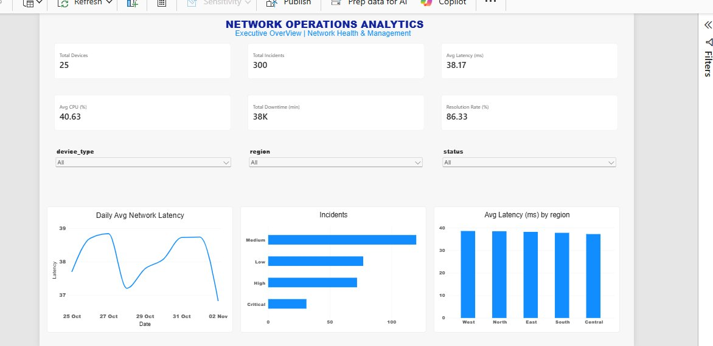
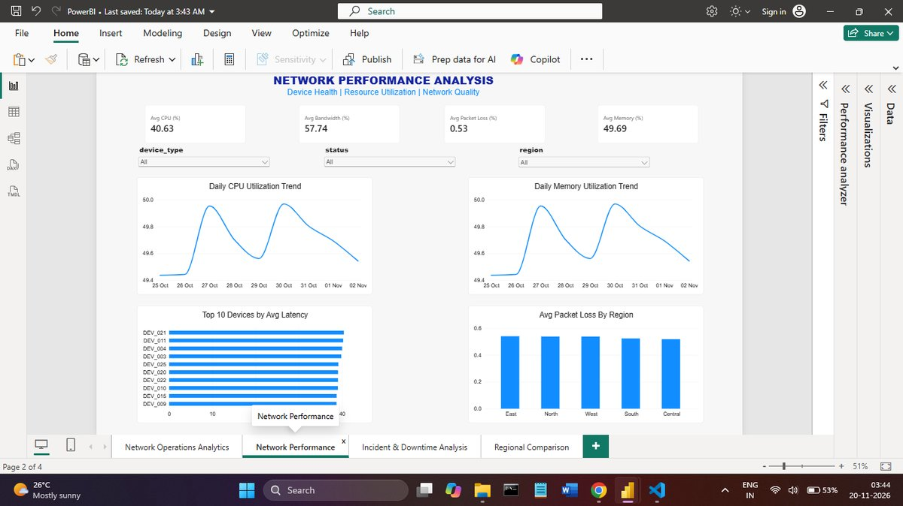
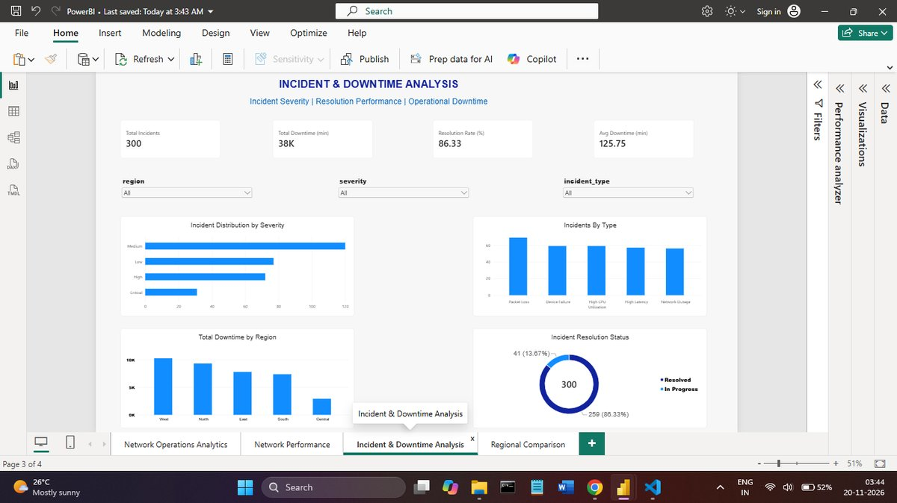
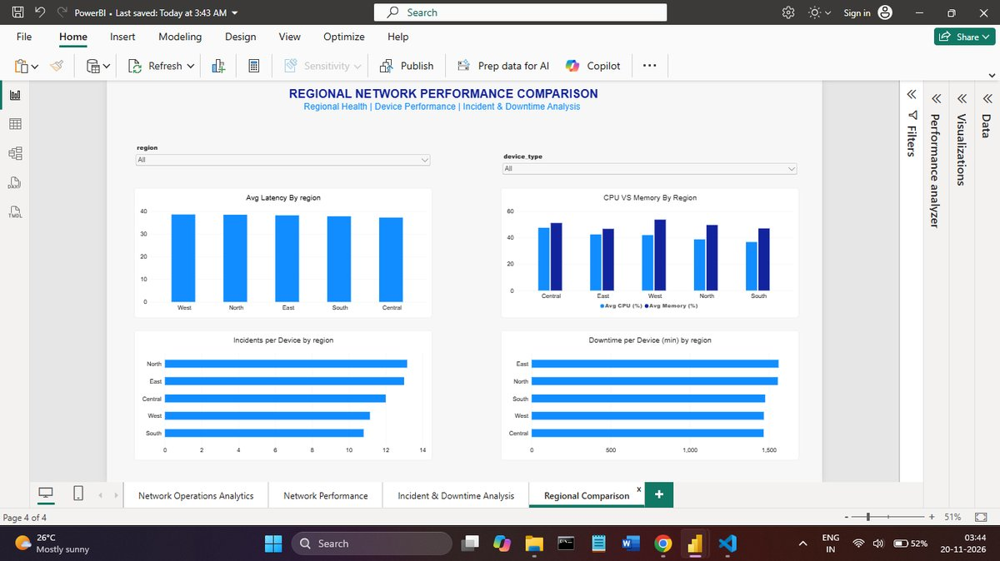

# Network Operations Analytics

## Project Overview

An end-to-end network operations analytics project that uses synthetic network telemetry and incident data to analyze network performance, identify operational patterns, and monitor downtime across regions and devices.

The project demonstrates data extraction, cleaning, exploratory analysis, SQL querying, data modeling, dashboard development, and automated data quality testing.

## Power BI Dashboard 

The project includes four interactive dashboard pages developed using Power BI.

### 1. Network Operations Analytics: Overall network and incident overview.


### 2. Network Performance: CPU, memory, latency, and packet loss analysis.


### 3. Incident Analysis: Incident severity, types, resolution status, and downtime.


### 4. Regional Comparison: Regional network performance, incidents per device, and downtime per device.


## Technology Stack

- **Python:** Data generation, cleaning, analysis, and testing
- **Pandas & NumPy:** Data manipulation
- **Matplotlib & Seaborn:** Exploratory data visualization
- **PostgreSQL:** Relational database and SQL analytics
- **Power BI:** Interactive reporting and dashboards
- **SQLAlchemy:** Python-to-PostgreSQL integration
- **Pytest:** Automated data quality testing
- **Git:** Version control

## Project Architecture

1. Generate synthetic network telemetry, device, and incident datasets.
2. Clean telemetry data by removing duplicates, handling missing values, and validating metric ranges.
3. Perform exploratory data analysis using Python.
4. Load the processed datasets into PostgreSQL.
5. Execute SQL queries for operational and regional analysis.
6. Build interactive Power BI dashboards.
7. Run automated data quality tests using pytest.

## Installation and Setup

### 1. Clone the repository

```bash
git clone https://github.com/Apurwakashyap/Network-Operations-Analytics.git
cd Network-Operations-Analytics
```

### 2. Create a virtual environment

```bash
python -m venv venv
```

Activate it on Windows:

```bash
venv\Scripts\activate
```

### 3. Install dependencies

```bash
pip install -r requirements.txt
```

### 4. Configure PostgreSQL

Create a PostgreSQL database named:

```sql
CREATE DATABASE network_operations_db;
```
``` env
DB_HOST=localhost
DB_PORT=5432
DB_NAME=network_operations_db
DB_USER=postgres
DB_PASSWORD=your_postgres_password
```

```Run the schema script to create the required tables and constraints:
psql -U your_postgres_username -d network_operations_db -f sql/schema.sql
```

Update the database credentials in `.env` with your local PostgreSQL configuration.

**Never commit your actual `.env` file.**

### 5. Generate and clean the data

```bash
python src/generate_data.py
python src/clean_data.py
```

### 6. Load data into PostgreSQL

```bash
python src/load_to_postgres.py
```

### 7. Run exploratory data analysis

```bash
python src/explore_data.py
python src/eda_analysis.py
```

### 8. Run automated tests

```bash
python -m pytest tests/ -v
```

## Dataset Overview

| Dataset | Description |
|---|---|
| Devices | Device type, region, location, installation year |
| Network Telemetry | CPU, memory, latency, packet loss, bandwidth, status |
| Incidents | Incident type, severity, downtime, resolution status |

The project uses synthetic data generated for demonstration purposes.

## Data Quality and Testing

Automated tests validate:

- Processed telemetry file availability
- Duplicate device-timestamp records
- Missing critical values
- Valid ranges for network performance metrics

Run the tests using:

```bash
python -m pytest tests/test_data_pipeline.py -v
```

## Project Structure

```text
Network_Operations_Analytics/
├── data/
│   ├── raw/
│   └── processed/
├── notebooks/
├── src/
├── sql/
├── tests/
├── dashboards/
    ├── screenshots/
├── requirements.txt
└── README.md
```

## Important Note

This project uses synthetic data. Its findings demonstrate analytical methods and reporting workflows; they should not be interpreted as measurements of a real production network or as proof of causal relationships.
